# PixelOffice

[](https://github.com/zann06/PixelOffice/actions/workflows/ci.yml)
[](https://github.com/zann06/PixelOffice/actions/workflows/deploy-pages.yml)

**Ruang kerja pixel-art untuk tim nyata.** PixelOffice membantu organisasi kampus, komunitas, dan tim kecil mengelola program kerja, tugas, rapat, penanggung jawab, tenggat, dan progres — semua tersambung dengan **kantor pixel-art yang hidup**.

> PixelOffice adalah alat produktivitas, bukan game. Karakter pixel hanyalah visualisasi dari data kerja yang tersimpan — mereka tidak menggantikan datanya.

## Tampilan

| Dasbor + kantor pixel | Panel tugas anggota |
| --- | --- |
| 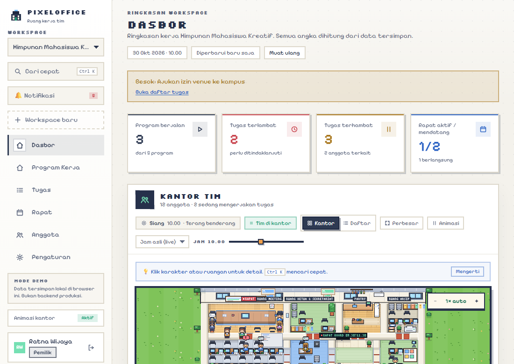 | 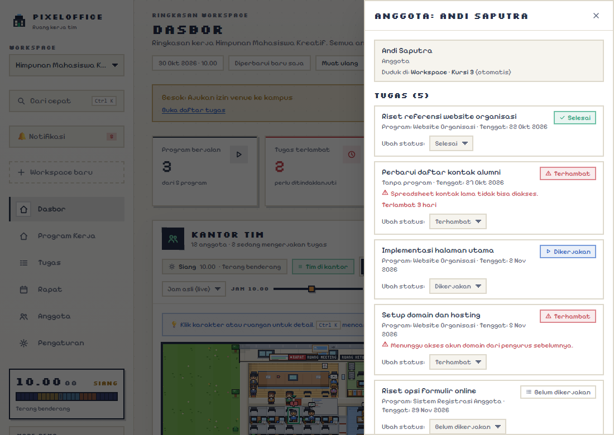 |

| Daftar tugas | Detail tugas + diskusi |
| --- | --- |
| 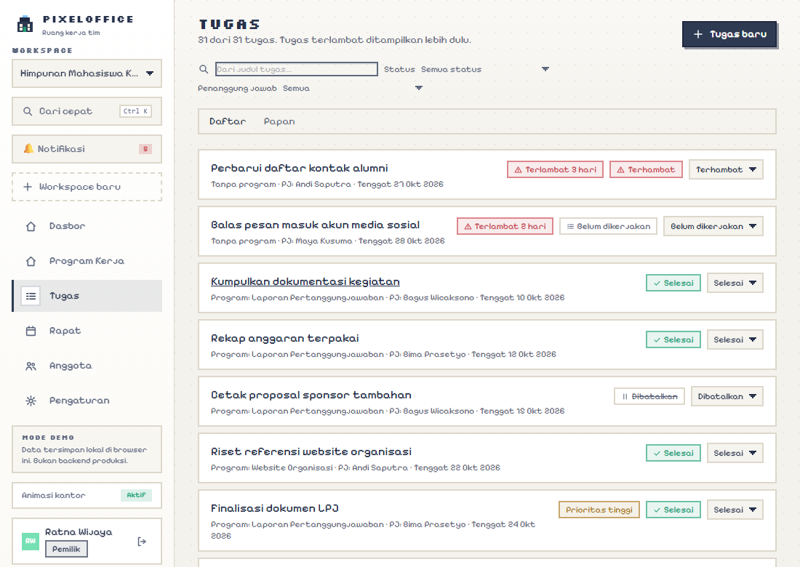 | 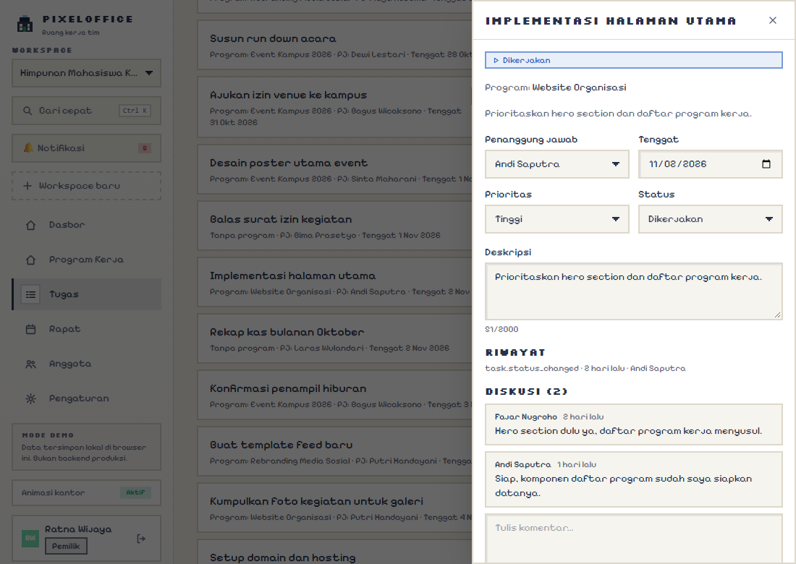 |

| Rapat & keputusan | Anggota & departemen |
| --- | --- |
| 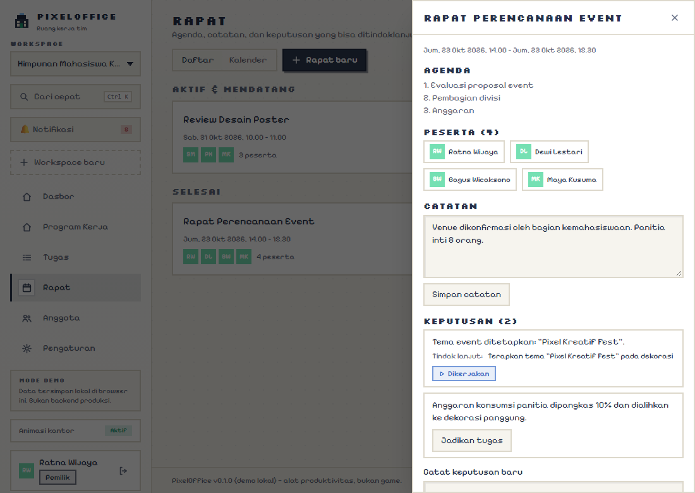 | 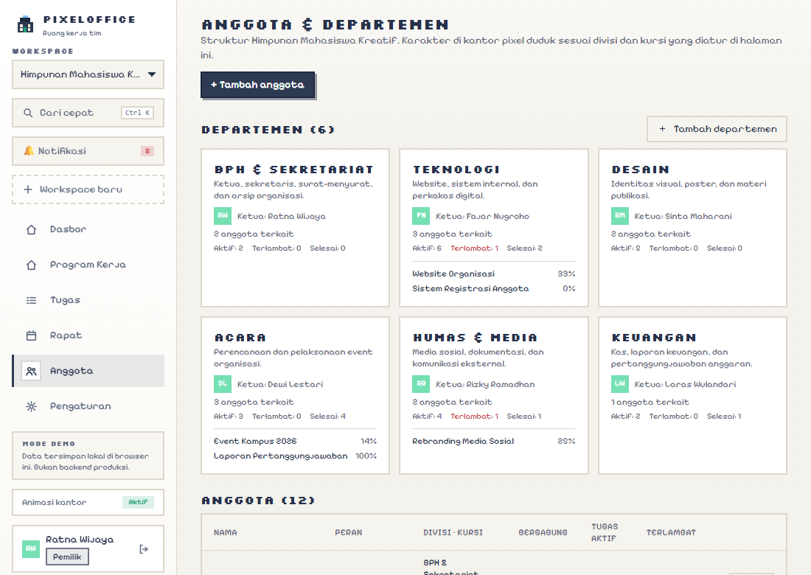 |

Waktu di scene mengikuti **jam nyata** — pagi, siang, sore, dan malam masing-masing punya pencahayaan sendiri:

| Pagi | Siang | Sore | Malam |
| --- | --- | --- | --- |
| 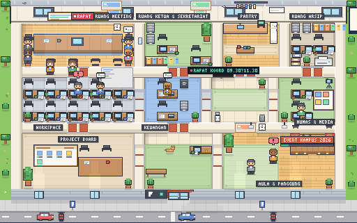 | 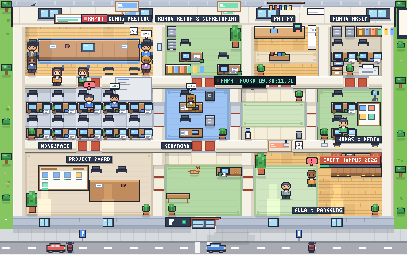 | 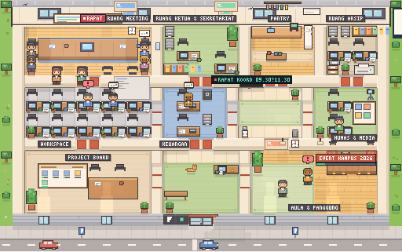 | 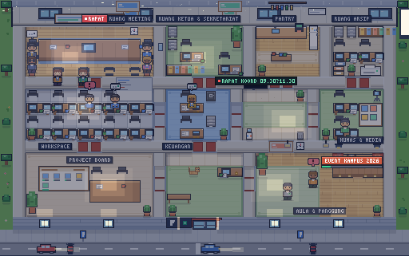 |

## Demo alur kerja

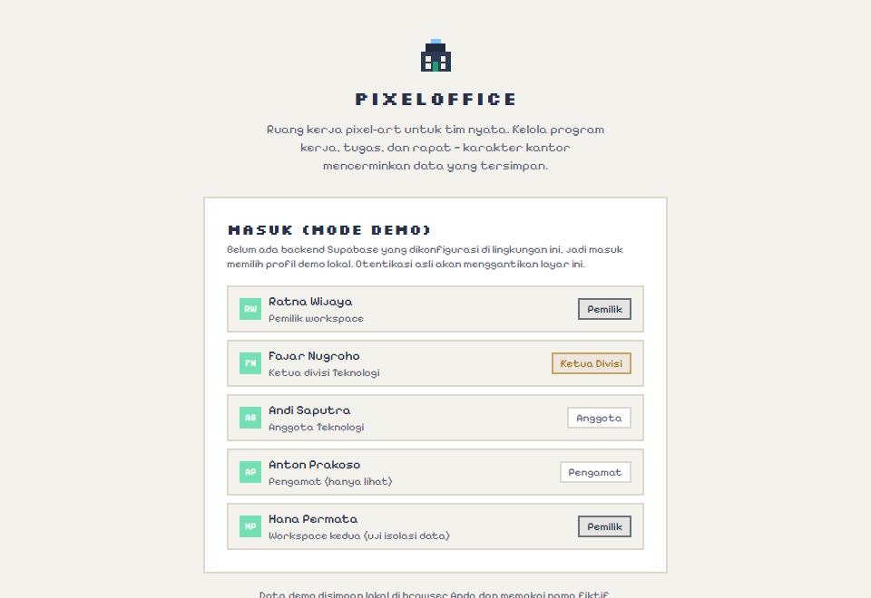

Yang terjadi pada GIF di atas — dan semua perubahannya **tersimpan**, langsung tercermin di dasbor maupun scene:

1. **Masuk** dengan memilih profil demo (Ratna — pemilik workspace).
2. **Dasbor** menampilkan metrik dari data tersimpan. Di kantor pixel, tiap anggota duduk di ruang divisinya, dan peserta rapat yang sedang berlangsung terlihat berkumpul di Ruang Meeting.
3. **Klik karakter** di scene — panel tugasnya terbuka, status bisa diubah langsung dari situ.
4. **Tugas**: ganti antara tampilan Daftar dan **Papan Kanban** (geser kartu antar kolom status), filter berdasarkan status/penanggung jawab, buat tugas baru.
5. **Rapat**: buka rapat, catat **keputusan**, lalu klik **"Jadikan tugas"** — keputusan langsung menjadi tugas tertaut tanpa duplikasi.
6. **Anggota** (pemilik/admin): tambah anggota baru, tentukan divisi dan kursinya di scene.
7. Semua perubahan tercatat di **log aktivitas** dan memperbarui progres program kerja.

## Cara mencoba

**Langsung online (tanpa install):** buka 🌐 [https://zann06.github.io/PixelOffice/](https://zann06.github.io/PixelOffice/)

**Atau jalankan lokal:**

```bash
npm install
npm run dev        # buka http://localhost:5173
```

Butuh Node.js versi LTS. Tanpa akun, tanpa server — **mode demo**: data fiktif tersimpan di browser Anda (localStorage).

### Pilih akun demo

| Profil | Peran | Cocok untuk mencoba |
| --- | --- | --- |
| Ratna Wijaya | Pemilik | Semua fitur: kelola anggota, buat departemen, ubah program |
| Fajar Nugroho | Ketua Divisi Teknologi | Kelola tugas divisi, rapat, keputusan |
| Andi Saputra | Anggota | Papan kanban, ubah status tugas sendiri (tanpa akses kelola) |
| Anton Prakoso | Pengamat | Tampilan hanya-baca (tidak bisa mengubah apa pun) |
| Hana Permata | Pemilik workspace kedua | Uji isolasi data antar workspace |

### Yang bisa Anda coba

- **Klik karakter** di kantor pixel — panel tugas anggota itu terbuka. Arahkan kursor ke ruangan untuk info; klik papan Project Board / TV koridor / papan pengumuman untuk lompat ke halaman terkait.
- **Amati jam kerja**: kantor ramai Senin–Jumat 08.00–18.00. Di luar jam itu scene jujur menampilkan kantor kosong lengkap dengan catatannya — dan tiap pagi pukul 08.00 anggota berjalan masuk lewat pintu ke meja masing-masing.
- **Ubah status tugas** lewat dropdown di baris tugas, atau **geser kartu** di papan kanban.
- **Buka rapat → catat keputusan → jadikan tugas** — tindak lanjut rapat tidak hilang.
- **Lonceng notifikasi** di sidebar: tugas terlambat, tenggat hari ini/besok, dan rapat mendatang.
- **Ctrl+K** untuk mencari cepat tugas, program, rapat, atau anggota.
- **Pengaturan**: ekspor CSV/JSON, impor data demo, reset data, dan pintasan keyboard.

### Catatan penting

- Data demo memakai **nama fiktif** dan tersimpan lokal di browser — aman, tidak ada server maupun data asli. Reset kapan pun dari Pengaturan.
- Scene **mengikuti data, bukan karangan**: karakter hanya terlihat bekerja jika benar-benar punya tugas berjalan, dan kantor kosong di luar jam kerja — jangan kaget jika membuka di malam hari.
- Tampilan **hanya mode terang** (sengaja, mengikuti gaya visual referensi).

## Rencana pengembangan berikutnya

**Bisa ditambahkan tanpa backend (demo lokal tetap utuh):** sebagian besar sudah masuk — papan kanban, kalender rapat, buat workspace + kelola departemen, pusat notifikasi, tugas berulang, statistik per divisi. Usulan berikutnya tetap menyambut kontribusi.

**Butuh Supabase asli (backend) — milestone berikutnya:**

- [ ] Autentikasi asli (email/magic link) + Postgres + Row Level Security.
- [ ] Undangan anggota via tautan aman yang kedaluwarsa.
- [ ] Realtime: perubahan tugas terlihat langsung antar anggota.
- [ ] Lampiran berkas pada tugas/rapat (private bucket).

## Teknologi

React + TypeScript + Vite · Tailwind CSS · Canvas renderer buatan sendiri (tanpa aset game pihak ketiga) · Vitest + React Testing Library · Playwright. Backend produksi direncanakan memakai Supabase (Auth + Postgres + RLS); titik penukarnya sudah disiapkan di `src/lib/data/index.ts`.

## Status proyek

Implementasi demo yang **berfungsi penuh**, terverifikasi **78 tes otomatis (16 file)** + **4 uji end-to-end Playwright**. Semua aturan izin divalidasi ulang di lapisan data pada setiap perubahan — tapi ingat, adapter lokal ini bukan pengganti keamanan server.

Skrip & aset: screenshot dan GIF di README dibuat sendiri lewat `npm run assets` (Playwright + gifenc) — tanpa konten pihak ketiga.

## Lisensi

MIT — lihat berkas [`LICENSE`](LICENSE). Semua aset (sprite, ikon, screenshot, GIF) dibuat sendiri untuk proyek ini dan ikut lisensi yang sama.
