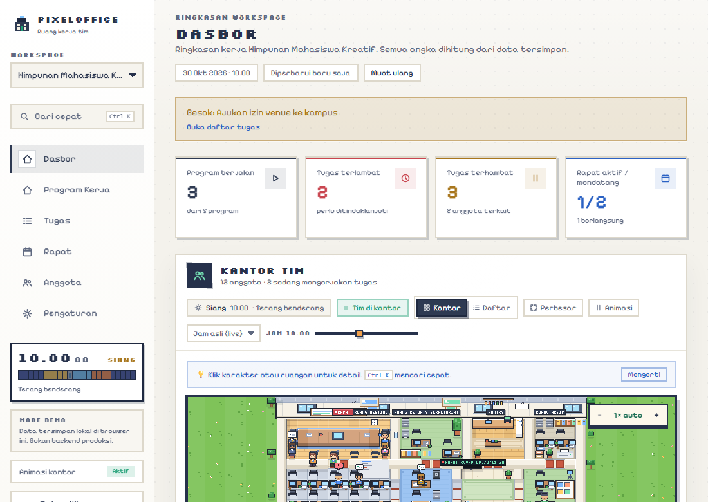
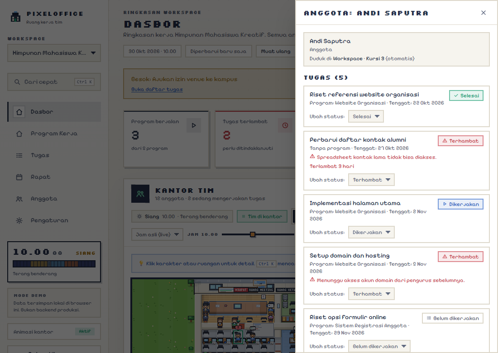
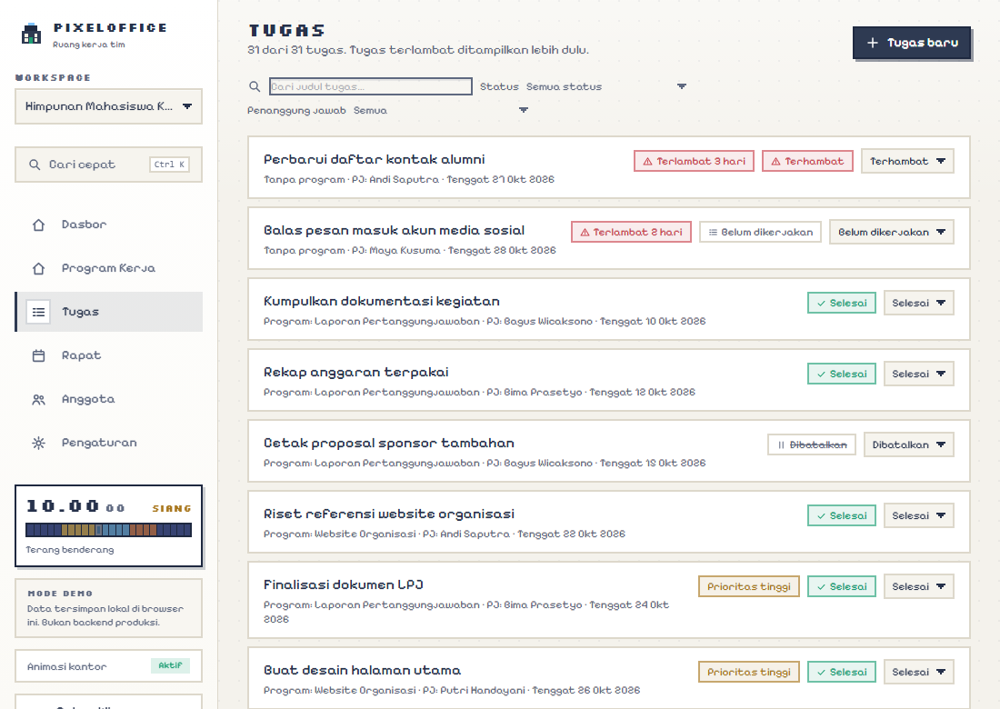
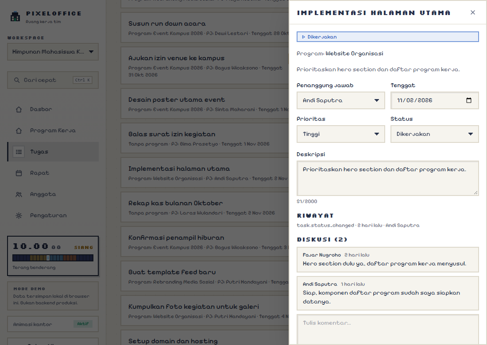
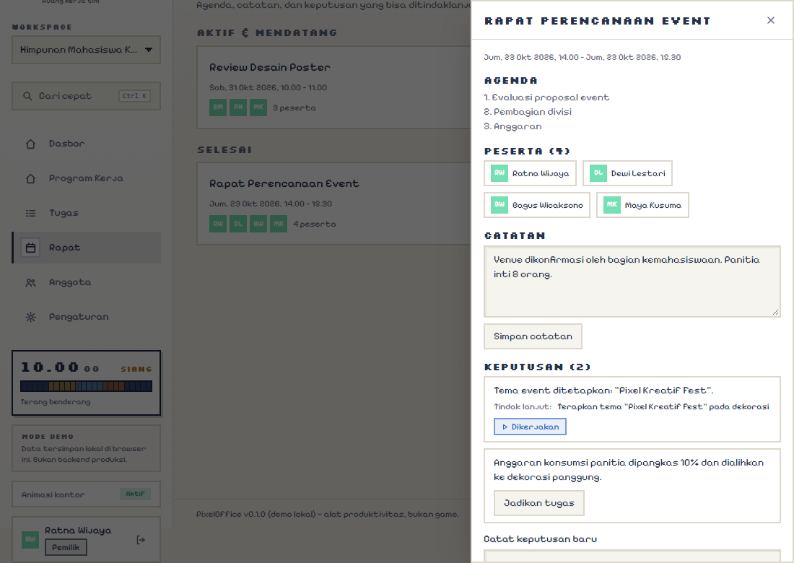
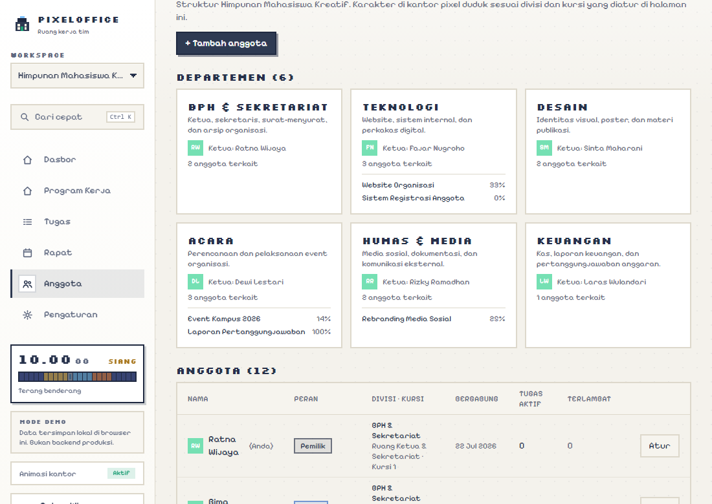
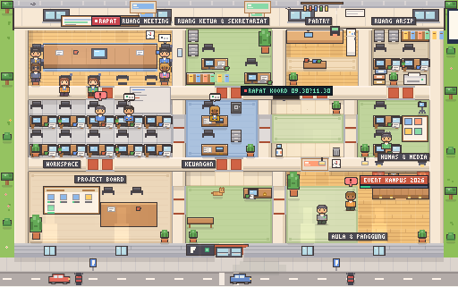
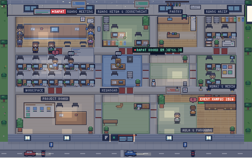
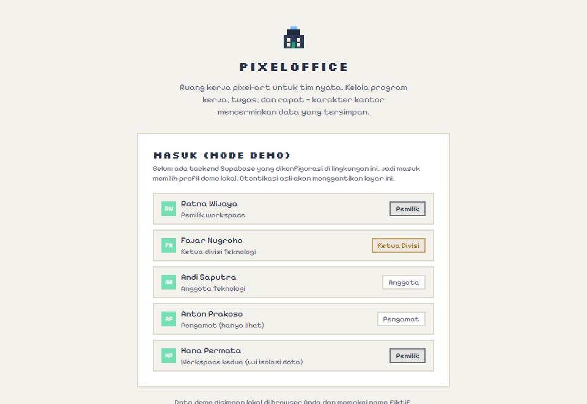

# PixelOffice

**A pixel-art workspace for real teams.** PixelOffice helps campus organizations, student clubs, committees, and small teams track work programs, tasks, meetings, ownership, deadlines, and progress through a shared workspace with an animated pixel-art office.

> PixelOffice is a productivity and coordination tool, not a game. Pixel characters visualize real team activity and workflow states; they do not replace the underlying task data.

## Tampilan

| Dasbor + kantor pixel | Panel anggota dari karakter |
| --- | --- |
|  |  |

| Tugas | Detail tugas + diskusi |
| --- | --- |
|  |  |

| Rapat & keputusan | Anggota & departemen |
| --- | --- |
|  |  |

Siklus waktu mengikuti jam nyata — pagi, siang, sore, dan malam masing-masing punya pencahayaan sendiri (lihat juga pratinjau fase di toolbar dasbor):

| Pagi | Siang | Sore | Malam |
| --- | --- | --- | --- |
|  |  |  |  |

## Demo alur kerja



Alur yang terlihat pada GIF di atas (semua perubahan tersimpan dan langsung tercermin di dasbor maupun scene):

1. **Masuk** memilih profil demo (Ratna — pemilik workspace).
2. **Dasbor** menampilkan metrik dari data tersimpan dan kantor pixel: karakter duduk di meja divisinya, peserta rapat yang sedang berlangsung terlihat di Ruang Meeting.
3. **Klik karakter** (atau anggota di daftar) membuka panel tugasnya — status bisa diubah langsung.
4. **Tugas**: filter status/penanggung jawab, ubah status (terlambat tampil lebih dulu), buat tugas baru.
5. **Rapat**: buka rapat, catat **keputusan**, lalu **"Jadikan tugas"** — keputusan menjadi tugas tertaut tanpa duplikasi.
6. **Anggota** (pemilik/admin): tambah anggota, atur divisi & kursinya di scene.
7. Setiap perubahan tercatat di **activity log**, memperbarui progres program, dan menggerakkan scene.

Scene juga bisa dinavigasi: papan Project Board membuka halaman Program Kerja, layar TV koridor menampilkan jadwal rapat nyata dan membuka halaman Rapat, dan papan pengumuman menunjukkan pin aktivitas (merah = tugas terhambat).

## Product principles

1. **Data first, pixel art second.** All status indicators and character activity must reflect actual saved data.
2. **One source of truth.** Work programs, tasks, meetings, decisions, and progress are linked.
3. **Clear ownership.** Every task has an accountable owner or an explicit unassigned state.
4. **Safe by default.** Workspaces are private by default; access is enforced on the server/database, not only in the UI.
5. **Accessible and responsive.** Pixel art enhances the experience but never blocks keyboard, screen-reader, reduced-motion, or mobile users.
6. **Open source, deployable by others.** No secret keys, private demo data, or proprietary assets are committed.

## Core workflow

`Create workspace → Invite members → Create department → Add work program → Break it into tasks → Assign owners and deadlines → Update progress → Review in meetings → Record decisions and follow-ups → Complete and report`

## Planned stack

- React + TypeScript + Vite
- Tailwind CSS for layout and tokens
- A small pixel-art renderer using CSS sprites or a tile/sprite canvas where appropriate
- Supabase Auth + Postgres + Row Level Security (RLS) for authentication and multi-tenant data
- Vitest + React Testing Library; Playwright for critical end-to-end flows
- Vercel or another static hosting provider for the frontend; Supabase for backend services

Pin exact versions in `package.json` and lockfiles during implementation. Avoid adding a 3D engine; this is a 2D pixel-art workspace.

## Documentation map

- [Product requirements](docs/PRD.md)
- [Visual reference and art direction](docs/REFERENCE.md)
- [Design system](docs/DESIGN_SYSTEM.md)
- [User flows](docs/USER_FLOWS.md)
- [Architecture](docs/ARCHITECTURE.md)
- [Data model](docs/DATA_MODEL.md)
- [Security](docs/SECURITY.md)
- [Roadmap](docs/ROADMAP.md)
- [Implementation notes](docs/IMPLEMENTATION_NOTES.md)
- [Enhancement summary](ENHANCEMENT_SUMMARY.md)
- [Contributing](CONTRIBUTING.md)

## Local setup

1. Install Node.js LTS (tested on Node 25).
2. Install dependencies with npm.
3. Run the development server.

```bash
npm install
npm run dev        # http://localhost:5173
npm test           # Vitest + RTL (71 tests, 15 files)
npm run lint       # ESLint
npm run typecheck  # strict TypeScript
npm run build      # production build
npm run e2e        # Playwright (npx playwright install chromium first)
npm run assets     # regenerate docs/screenshots/*.png + demo.gif
```

Pick a demo profile on the sign-in screen (e.g. Ratna — owner, Fajar — lead, Andi — member, Hana — second workspace for isolation testing). Demo data is fictional and stored in your browser's localStorage; reset, export, or import it from Settings.

## Project status

This repository contains a **working demo implementation** of the specification, verified by **71 automated tests (Vitest + React Testing Library, 15 files)** and **4 Playwright end-to-end tests**. See [docs/IMPLEMENTATION_NOTES.md](docs/IMPLEMENTATION_NOTES.md) and [ENHANCEMENT_SUMMARY.md](ENHANCEMENT_SUMMARY.md) for the precise boundary between what is real and what is not.

Implemented and tested:
- Responsive app shell (Indonesian UI) with dashboard, work programs, tasks, meetings, members, and settings.
- Pixel-art office scene rendered procedurally from **original** assets at 3× internal scale: characters sit at their division's room (BPH → Ruang Ketua, Keuangan, Humas & Media, Acara → Aula), walk between rooms through doorways when their seat changes, and show typing/working states derived from saved tasks.
- Real-clock day cycle (pagi/siang/sore/malam lighting) and office-hours presence: outside Sen–Jum 08.00–18.00 the office is honestly empty with an explanatory note.
- Work programs with documented progress calculation, tasks with statuses/assignees/due dates/comments, meetings with agenda/notes/decisions, decision → follow-up task conversion, CSV export.
- Member management (owner/admin): add members, assign division and scene seat, change roles — enforced in the data layer, no self-elevation.
- Corridor display with the real meeting schedule, clickable scene hotspots, activity feed, command palette (Ctrl/⌘K), due-soon reminders, trend chart, CSV/JSON export, keyboard + screen-reader alternatives for the scene, and reduced-motion support.

Not implemented yet (honestly out of scope for this pass):
- Real Supabase Auth + Postgres + RLS backend — the demo adapter enforces the same rules locally but is **not** a security boundary. The swap point is `src/lib/data/index.ts`.
- Email invitations, notifications, realtime, and file attachments.

## License

MIT is a reasonable default for the application code. Before release, add a `LICENSE` file and separately verify the licenses of every font, sprite, sound, and third-party asset. See [REFERENCE.md](docs/REFERENCE.md).
